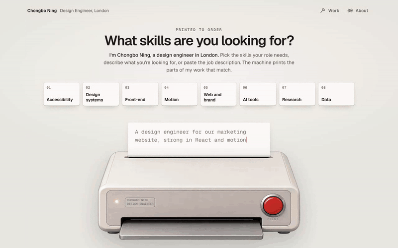

# Chongbo Ning — Design Engineer



The portfolio of Chongbo Ning, a design engineer in London. A red ticket printer sits on the page: type what your team cares about, press **Print**, and it prints a ticket with the part of my work that answers it. Every project is also a short case file you can read without asking anything.

- `/` — the machine and the tray of case files
- `/ask?brief=…&topics=a,b` (or the older `?q=…`) — the same answer, server-rendered (works without JavaScript; shareable; `noindex`)
- `/work/<slug>` — a case file per project, every section deep-linkable (`/work/<slug>#<section-id>`)
- `/about` — profile, education and contact

## Stack

Next.js 16 (App Router) · TypeScript (strict) · Tailwind CSS v4 · Zod · Anthropic TypeScript SDK · Geist and Geist Mono (self-hosted via the `geist` package) · Vitest · Playwright + axe-core.

Motion is plain CSS and the Web Animations API (no animation library): the thermal-printer feed is a `steps()` height transition, and the shell's capsule links (`src/components/nav/Pill.tsx`) animate with `element.animate()`, so the client bundle stays small.

## Run locally

```bash
npm install
cp .env.example .env.local   # optional: add ANTHROPIC_API_KEY
npm run dev                  # http://localhost:3000
```

Quality gates:

```bash
npm run lint
npm run typecheck
npm test            # unit tests (Vitest)
npm run build
npm run contrast    # WCAG AA check of every colour pairing in use
npm run test:e2e    # Playwright + axe at 1440 and 390 (needs `npm run build` first)
npm run screenshots # writes docs/screenshots/*.png
node scripts/printing-gif.mjs  # writes docs/screenshots/printing.gif (needs ffmpeg and `npx next start -p 3100`)
```

Playwright uses a system Chromium at `/opt/pw-browsers/chromium-1194/chrome-linux/chrome` by default. Elsewhere, run `npx playwright install chromium` and set `PW_CHROMIUM` to that binary (or remove `executablePath` from `playwright.config.ts`).

`content/index.ts` is server-only. The browser-test scripts set Node's `react-server` condition so tests can read the catalogue. For direct Playwright commands, use `NODE_OPTIONS=--conditions=react-server npx playwright test`.

The real PostHog SDK browser checks are opt-in so a keyless build can still run the normal suite:

```bash
NEXT_PUBLIC_POSTHOG_KEY=phc_local_verification npm run build
ANALYTICS_E2E=1 npm run test:e2e -- tests/e2e/interaction-analytics.spec.ts --project=desktop --project=mobile
```

Those tests intercept every `/ingest` request and block external requests, so test events never reach a PostHog project.

Every `npm run build` also checks `.next/static` for hidden project titles and body text. The build fails if any is found, including escaped text in JavaScript or source maps.

## Environment variables

| Name | Where | Purpose |
|---|---|---|
| `ANTHROPIC_API_KEY` | server only | Lets Claude choose the answer cards. Optional: without it the keyword fallback answers everything. |
| `NEXT_PUBLIC_SITE_URL` | build + server | Public URL for canonical links, sitemap and Open Graph images, e.g. `https://chongbo.dev`. Defaults to `http://localhost:3000`. |
| `ASK_RATE_LIMIT` | server, optional | Questions per IP per minute (default 12). |
| `ASK_DAILY_CAP` | server, optional | Best-effort daily cap on model calls per server instance (default 1500). Past the cap, answers come from the fallback. |
| `NEXT_PUBLIC_POSTHOG_KEY` | build | Turns on visitor analytics (PostHog, EU cloud, cookieless). Without it nothing is loaded or sent. |
| `NEXT_PUBLIC_POSTHOG_DEBUG` | build, optional | `1` logs PostHog's activity in the browser console. |

## Visitor analytics

`src/instrumentation-client.ts` starts PostHog when `NEXT_PUBLIC_POSTHOG_KEY` is set; `src/lib/analytics.ts` lists the events. Cookieless (no cookies or browser storage; turn on "Cookieless server hash mode" in the PostHog project settings, or events are dropped), no session recording, no autocapture, sent through `/ingest` on this site (rewrites in `next.config.ts`).

Events: `$pageview` / `$pageleave`, `skill_toggled`, `request_submitted`, `request_opened`, `request_cancelled`, `printed`, `sheet_viewed`, `read_in_context_clicked`, `case_card_viewed`, `contact_clicked`, and `outbound_clicked`.

- `request_submitted` records the **submitted question verbatim** in `brief` (up to the same 4,000-character input limit as the printer), plus selected `topics` and `skills`. Drafts and keystrokes are not captured. Opening `/ask` records `request_opened` with `input_origin=url`, so a shared result is not counted as a fresh submission.
- Each request gets a random `request_id`. Its `printed` event carries ordered `cards`, `asked`, `source` (model/fallback/curated), and `ok`. A failure has `ok=false` and `error_kind`; stopping a print emits `request_cancelled`. Subsequent card views, case links, pageviews and contact clicks carry the latest request id. The raw brief is on the request event, not copied onto every later event.
- `sheet_viewed` and `case_card_viewed` measure foreground visibility on the printer, `/ask`, and case pages. At least half the card on **both axes** (or half the viewport for oversized cards) must remain visible for 1.5 seconds. `seconds` measures each qualifying interval; sum intervals for total visible time. Background time and fast swipes do not count. This measures visibility, not proof of reading.
- `company` comes from `/for/<company>` or `ref`; `ref` remains available for existing filters. `channel` comes from `utm_source`, or the external referrer when available. `utm_medium` and `utm_campaign` are also kept. A missing referrer is `direct_or_unknown`, never assumed to be LinkedIn. Company labels describe the link, not the visitor's identity or employer.
- `visit_id` joins events in this open page across client-side navigation. These ids and attribution live **only in memory**: reloads or new tabs start a new visit, and reloading an untagged case URL loses its company/request context. No cookies, browser storage, login, `identify()`, or session recording are added.
- `ref=test` suppresses **all analytics events**, including automatic pageviews and pageleaves, for the rest of that open-page visit. It does not erase historical test events: exclude `ref=test` when reviewing older data. Early interactions queue briefly in memory while the SDK loads; no key means no event collection.

To inspect a journey in PostHog Activity, filter `company=granola`, then copy a `request_submitted` event's `request_id` into a property filter. This shows the question, printed cards and follow-on interactions; filter `visit_id` to include earlier pageviews and skill selection. Add a `channel` breakdown to compare where links were opened. For a tagged LinkedIn link use `/for/granola?utm_source=linkedin`; keep `/for/granola?ref=test&utm_source=linkedin` for self-checks.

## Application links

Send `/for/granola` for Granola's **Design Engineer (Web & Brand)** role. It opens the home-page printer, with **Picked for Granola** replacing the Research option and placed last, using Granola's logo and an olive border. Nothing is preselected or printed on arrival. Selecting that option and pressing Print produces five hand-picked cards in order: Design system 01.3, 02.1, 02.2; Nike 01.1; HHCD 02.6.

Edit `content/applications.ts` to add a company, change its ordered public card keys, or choose which skill option it replaces, then deploy. Only the current company's selection is passed to the printer. Unknown names redirect home; `/for/*` carries both a noindex header and page metadata and stays out of the sitemap.

The curated option is exclusive with ordinary skills. Typing a request clears it and uses the existing `/api/ask` flow, including AI selection when configured and available. Ordinary skills still use deterministic topic matching. A curated print is labelled as picked by Chongbo and tracked with `source=curated`; it does not call the model or limit future requests to those five cards.

During client-side navigation, the name, Back Home, and New request links return application visitors to their `/for/<company>` printer and preserve `ref`, `utm_source`, `utm_medium`, and `utm_campaign`. The return address lives only in the open page's memory; ordinary visits still return to `/`. Reloading or opening an untagged work/about URL starts without that application context, as does the cookieless analytics attribution. No cookies or browser storage are added.

The clean path supplies `company=granola` and `ref=granola` to analytics. For your own checks, use `/for/granola?ref=test` to suppress events. In PostHog, filter events by `company = granola` (or `ref = granola` for older data). Check `$pageview`, `printed`, `sheet_viewed`, `read_in_context_clicked`, `case_card_viewed` and `contact_clicked`. Receiving events still depends on the production key and PostHog cookieless server hash setting.

## How "ask" works

All content lives in `content/` (typed by `content/schema.ts`). Each project is an ordered list of section cards, and each card carries **signals** (accessibility, design systems, …). The ask feature never writes the page; it only **chooses** cards.

`POST /api/ask` with `{ "brief"?: "…", "topics"?: ["accessibility"] }` (brief 0–4,000 characters, 0–6 signal keys, at least one present; validated with Zod; the old `{ "question": "…" }` is still accepted as the brief) returns the cards that answer it best, across all projects:

```json
{
  "asked": ["accessibility"],
  "sheets": [{ "project": "hhcd-data-platform", "section": "dual-view", "signal": "accessibility", "reason": "≤90 chars" }],
  "missing": ["A/B testing"],
  "line": "Three cards show accessibility.",
  "source": "model",
  "reply": "…", "picks": [], "matched": "accessibility"
}
```

`asked` is 1–6 signal keys, most important first. `sheets` is 1–6 cards, never the same card twice, several from one project when they answer best; each links to `/work/<project>#<section>`. Cards from one project are printed together. `missing` lists requested things no work shows. `reply`, `picks` and `matched` are the old fields, derived from the new ones so the current home page keeps working.

The schema is shared by the API route, the `/ask` page and the client (`src/lib/ask/schema.ts`).

1. **Rate limit** (`src/lib/ask/rate-limit.ts`): a per-IP sliding window. Over the limit → `429` and the machine prints a small "Paused" ticket. Question text is never logged.
2. **Model path** (`src/lib/ask/model.ts`): if `ANTHROPIC_API_KEY` is set and the daily cap allows, `claude-sonnet-5-5` at low effort is called through the official SDK with structured JSON output (`output_config.format` via `zodOutputFormat`). The system prompt is a catalogue built from `content/` (project and section ids, titles, kinds, signals, each card's full text, each project's stack), cached between requests. The model only **ranks**: the capabilities asked for, what's missing, and up to ten cards that genuinely answer, best first. An empty list means nothing answers, and the site prints its own places to start. The visitor's brief is wrapped and treated as data. A 10-second timeout applies; there are no retries. When the model path gives up, the server log says why (never the brief).
3. **Sanitising** (`src/lib/ask/sanitize.ts`, `fallback.ts` `verifyMissing`): cards that don't exist are dropped, each card is kept once, and a card prints only for an asked capability its own signals carry. A `missing` label is printed only if it is a skill or tool: never a project (hidden ones included), a person or an organisation, and never something a card or the stack shows. Topics the visitor chose always count as asked. If no valid card remains, it falls back.
4. **Arranging** (`src/lib/ask/arrange.ts`), the same for both paths: a requested count ("2 projects": the two strongest projects' cards; "3 examples": three cards), then a spread by capability (each asked capability gets its best card before any gets a second), at most six, never padded; cards from one project sit together. The line ("Four cards from two projects match your brief.") is written by the site, never the model.
5. **Fallback** (`src/lib/ask/fallback.ts`): scores the brief against signal synonyms to find the capabilities asked for (chosen topics first), then ranks every card whose first or second signal is one of them, across all projects (the first signal weighs most, then word overlap). A short list of common asks the content never mentions (A/B testing, native iOS or Android, Swift, Kotlin, databases, analytics) is reported as `missing`. If nothing is understood, it prints three strong defaults. Used for topic-only requests, and when there is no key, on error, timeout, refusal, or past the daily cap.

The eval set is `tests/eval/cases.ts`; `npm run eval:printer` runs it against the live model (about $0.04 a run; `MODEL=… EFFORT=… RUNS=…` to compare).

On the page, the LED blinks and a lip of paper inches at the slot while waiting; the ticket prints when the answer arrives (at least ~400 ms so the motion reads, no other artificial delay). Focus then moves to the ticket and the reply is announced in a polite live region. With reduced motion, everything is instant.

### Swapping the rate limiter for a hosted store

The in-memory limiter is per server instance, so on Vercel each warm instance counts separately. To make it global, implement the `RateLimiter` interface with Upstash Redis (available through the Vercel Marketplace):

```ts
// src/lib/ask/rate-limit.ts
import { Ratelimit } from "@upstash/ratelimit";
import { Redis } from "@upstash/redis";

const upstash = new Ratelimit({ redis: Redis.fromEnv(), limiter: Ratelimit.slidingWindow(12, "1 m") });
export const askLimiter: RateLimiter = {
  async limit(key) {
    const r = await upstash.limit(key);
    return { ok: r.success, remaining: r.remaining, retryAfterSec: Math.max(1, Math.ceil((r.reset - Date.now()) / 1000)) };
  },
};
```

Then `npm i @upstash/ratelimit @upstash/redis` and set `UPSTASH_REDIS_REST_URL` and `UPSTASH_REDIS_REST_TOKEN`. Nothing else changes. The daily cap can move to the same store with `INCR` on a key like `ask:2026-10-10` with a 24-hour expiry.

## Add a project

1. Create `content/projects/<slug>.ts` exporting a `Project` (copy an existing file for the shape).
2. Import it in `content/index.ts` and add it to `projects` (order = tray order). `tier: "main"` puts it in the tray; `"earlier"` puts it in the "Earlier work" line.
3. Add a short place label in `TRAY_PLACE` in `src/lib/site.ts` (optional).

The case file page, OG image, sitemap entry, AI catalogue and fallback scoring all pick it up automatically.

## Assets

Images and video referenced by content live in `public/assets/<path>`. Missing files show a labelled placeholder with the path and what to supply. The full checklist (with Chinese notes) is in [`docs/ASSETS.md`](docs/ASSETS.md).

## Deploy to Vercel

1. Push this repo to GitHub (already done: `CBcbbb/chongbo.DesignEngineer`).
2. In [vercel.com](https://vercel.com) → **Add New… → Project** → import the repo. Framework preset: **Next.js**. Leave build and output settings as default.
3. Under **Environment Variables** add:
   - `NEXT_PUBLIC_SITE_URL` = the final URL (e.g. `https://chongbo-designengineer.vercel.app`, or your domain).
   - `ANTHROPIC_API_KEY` = a key from the Claude Console (optional; see REPORT.md for setting a spend limit).
4. Click **Deploy**. When it finishes, open the URL on desktop and phone and ask a question. The footer of each answer ticket doesn't say which path answered; check `source` in the browser's network tab (`model` or `fallback`).
5. If you add a custom domain later, update `NEXT_PUBLIC_SITE_URL` and redeploy so canonical links and OG images use it.

## Project layout

```
content/              typed content: the single source of truth
src/app/              routes, metadata, OG images, sitemap, robots
src/app/tokens.css    design tokens (light + dark)
src/app/components.css component styles (Tailwind components layer)
src/components/       Machine (client), Ticket, Tray, MediaSlot, diagrams
src/lib/ask/          schema, catalogue, model, fallback, sanitise, rate limit
scripts/contrast.ts   WCAG contrast check
tests/unit/           Vitest
tests/e2e/            Playwright + axe, screenshots
docs/design/          the approved prototype and reference screens
```
